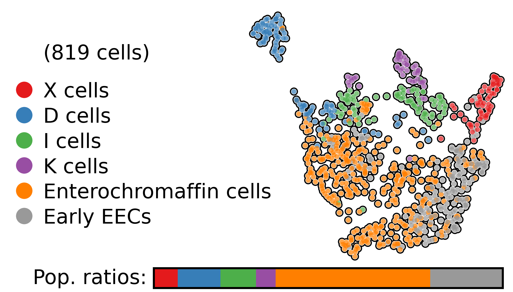

# EGFR Inhibition Promotes Enteroendocrine Cell Differentiation 

<p align="left">
  
</p>


## What's this?

This repository is a copy of the code used in the single cell analyses performed in the 'EGFR INHIBITION PROMOTES ENTEROENDOCRINE CELL DIFFERENTIATION CONTRIBUTING TO TREATMENT-ASSOCIATED DIARRHEA' (Biorxiv 2026). 

The code is provided here in the interest of transparency and reproducibility, and displays all steps for data processing downstream of CellRanger v10.0 called on the raw FASTQ, which can be accessed on GEO.

## Downloading the data.

The final GEO submission will be available at GSE329493. The data are available as raw FASTQ files, as well as an intermediate matrix, and metadata sheet. Separate libraries were prepared from duodenal organoids sequenced at Day 2, 4, and 10 of the breault lab differentiation protocol, in both a control and a Lapatinib treated condition for each, excluding D10 (Lapatinib only).

Each library goes into `data/data-objects/raw/` under the file name listed in `src/config.py` (`DATASETS[...]["raw"]`), e.g. `egfDuod_D2_DZ.h5ad`. To build these from CellRanger output:

```bash
python r-src/build_h5ad_from_10x.py \
    --tenx-h5 D2_DZ/outs/filtered_feature_bc_matrix.h5 \
    --sample D2_DZ --condition Dz --timepoint 2 --treatment Dz \
    --freemuxlet D2_DZ/freemuxlet_output.tsv \
    --out data/data-objects/raw/egfDuod_D2_DZ.h5ad
```

## Running the code.

Each notebook folder is one dataset, run as a sequence of notebooks that share the standardised steps in `src/`. The run order and the conda environment for each notebook are listed in [`pipeline.yaml`](pipeline.yaml).

```bash
# 1. Environments (once). The full pinned export, conda/single-cell-env.yaml, targets macOS ARM.
conda env create -f conda/single-cell-env-minimal.yaml
conda env create -f conda/decoupler-env.yaml
conda env create -f conda/pydeseq-env.yaml
for env in single-cell-env decoupler-env pydeseq-env; do
    conda run -n $env python -m ipykernel install --user --name $env
done

# 2. Run (from single-cell-env)
conda activate single-cell-env
python scripts/run_pipeline.py --list     # the plan, and which raw inputs are present
python scripts/run_pipeline.py D2_DZ      # one dataset, every step in order
python scripts/run_pipeline.py --all      # every dataset, then pseudobulk DGE and GSEA
```

Executed copies of each notebook, with outputs, go to `data/executed-notebooks/`. Figures go to `figures/`. You can also open the notebooks in Jupyter and run them in order by hand.

To check the code without any data:

```bash
python scripts/check_notebooks.py   # imports resolve, paths connect, each step's inputs exist
pytest tests/                       # src/ functions on a small synthetic dataset
```

[`docs/PIPELINE.md`](docs/PIPELINE.md) describes each step, where it writes, the AnnData conventions and the analysis parameters.

## Repository layout

```
notebooks/<dataset>/   one folder per library, steps 0 (QC) to 6 (TF activity)
notebooks/dge/         pseudobulk DESeq2, one run per comparison in dge_comparisons.yaml
notebooks/gsea/        GSEA prerank on the DGE results
src/                   shared code: paths and dataset registry (config.py), markers, palettes, pipeline steps
resources/             CellAssign marker matrices and other fixed inputs
conda/                 environment files
scripts/               run_pipeline.py, check_notebooks.py
tests/                 tests on synthetic data
r-src/                 conversion from CellRanger / Seurat to h5ad
data/, figures/        outputs (not tracked)
```
